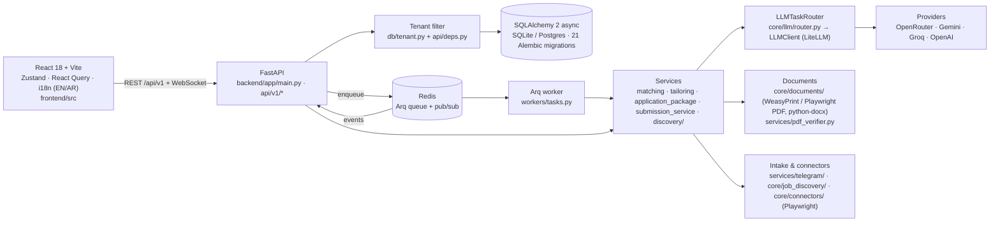

# SA Job Orchestrator — Architecture

A multi-tenant, human-in-the-loop job-application platform: opportunities come in (manual paste, Telegram, discovery providers), are matched against a candidate profile with an explainable report, the CV is tailored change-by-change with evidence links, and an application package (PDF/DOCX + match report) is versioned, hashed and approved before any send or submit. Live submission is off by default (`APPLY_MODE=review`).

**Provenance.** Fork of Rayyan9477's *AutoApply AI* (`docs/ATTRIBUTION.md`). Upstream history ends at commit `bc86d7e` (2026-08-04). Saed Alsafadi's 35 commits (2026-08-20 → 2026-11-15) change 401 files, +35k/−2.5k lines. Per-file ownership is visible with `git log --format=%an -- <path>`.

## Components

## Request / data flow: intake → match → tailor → package → approve

1. **Intake.** `POST /api/v1/opportunities/ingest` (`api/v1/opportunities.py`), the Telegram handler (`services/telegram/intake.py`) or discovery (`services/discovery/orchestrator.py`) create a `Job` row carrying `user_id`; the worker task `process_opportunity` (`workers/tasks.py`) normalises it and resolves an application route (`services/application_route_resolver.py`).
2. **Match.** `POST /workflow/jobs/{id}/match` → `WorkflowService.match_candidate` → `CandidateJobMatcher.match_candidate` (`services/matching.py`): `normalize_job_data` (LLM), `evaluate_eligibility` (deterministic rules, `services/eligibility.py`), then one `MATCH_DEEP` structured call on the heavy model. Eligibility blockers override the LLM verdict.
3. **Tailor.** `POST /tailoring/start` → `services/tailoring.py: start_tailoring_session`: `CV_TAILOR` produces changes with `linked_evidence_ids`; `CV_REVIEW` flags invented facts as BLOCKED; `_rejected_novel_fragments` strips text with no evidence. The user accepts/rejects each change in `CVTailoringWorkbench.tsx`; `finalize_session` merges accepted changes (`tailoring_merge.py`) and renders a `Resume`.
4. **Package.** `services/application_package.py: create_or_update_package` hashes the component set with `compute_content_hash` (SHA-256), bumps `version`, and marks the previous row `is_current=False`. `pdf_verifier.py` checks the rendered PDF.
5. **Approve / send.** `POST /applications/{id}/package/approve` (`api/v1/packages.py`) binds the approval to `(package_id, content_hash)`; regenerating the package produces a new id/hash, so the old approval cannot authorise it. `SubmissionService.approve_and_submit` consumes a single-use `ApplicationApproval` before any Playwright connector runs.

**Tenancy.** `get_tenant_db` sets a `ContextVar`; a `do_orm_execute` listener in `db/tenant.py` injects `WHERE user_id = :uid` into every ORM SELECT on `TenantMixin` models. Inserts and bulk updates must still set/filter `user_id` explicitly.

## Key design decisions and trade-offs

| Decision | Why | Cost |
|---|---|---|
| Static light/heavy task map in `LLMTaskRouter` | Cheap model for classification/cleanup, strong model for match/tailor; one place to change models | No dynamic escalation; a mis-sized task needs a code change |
| Pydantic structured output with one bounded repair retry, fail-closed | No silent fallback to another model; provider/quota errors propagate | If both attempts fail the task fails; user sees an error instead of a degraded answer |
| Versioned packages + hash-bound approval | Prevents approving version 3 and sending version 4 | Every regeneration forces re-approval, which adds friction |
| Tenant filter at the ORM event layer | Forgetting a `.where(user_id=)` is safe for reads | SELECT-only; worker paths must set the context var; opt-out flag exists |
| Arq + Redis worker | Long LLM/browser jobs leave the request thread; WebSocket progress via pub/sub | Redis is a hard dependency for queue and events |
| Fail-closed defaults (review mode, no SMTP, no Playwright, Telegram off) | Safe to run and demo | Much of the submission path is never exercised in CI |

## Known limitations

- `CandidateJobMatcher._compute_deterministic_features` returns zeros ("dummy for now"): the match score is LLM judgement plus rule-based eligibility, not a hybrid scorer.
- CI (`.github/workflows/ci.yml`) ignores four unit-test files and runs integration tests with `|| true`; the documented baseline (788 backend / 152 frontend passing) is from local runs. Upstream wrote most test files (74 of 102 backend files, 30 of 34 frontend files by first author).
- `browser-use` API drift: browser-use-based automation tests are skipped (`docs/KNOWN_LIMITATIONS.md`). Playwright connectors for Workable/Greenhouse/Lever are the working path.
- Scratch scripts are committed under `backend/` (`test_api.py`, `state.json`, `test_pw.png`, …) and `services/job_search.py.tmp`.
- `WorkflowService.generate_resume_pdf` hard-codes `gemini-3.5-flash` in `audit_metadata` while the configured heavy model is OpenRouter/DeepSeek (`config/settings.py`).
- `docs/` says 23 migrations; `db/migrations/versions/` holds 21. No LICENSE file (upstream has none), so the code is not openly reusable.
- No hosted deployment; default database is SQLite; Arabic PDF quality depends on the provider and WeasyPrint RTL support.
